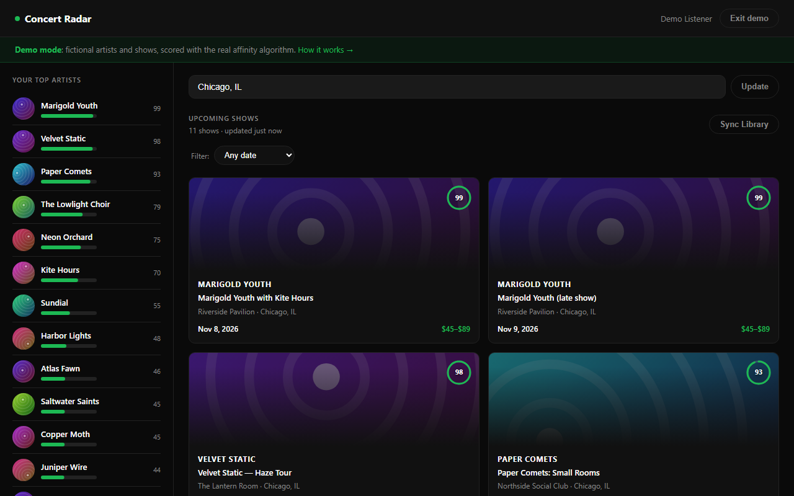
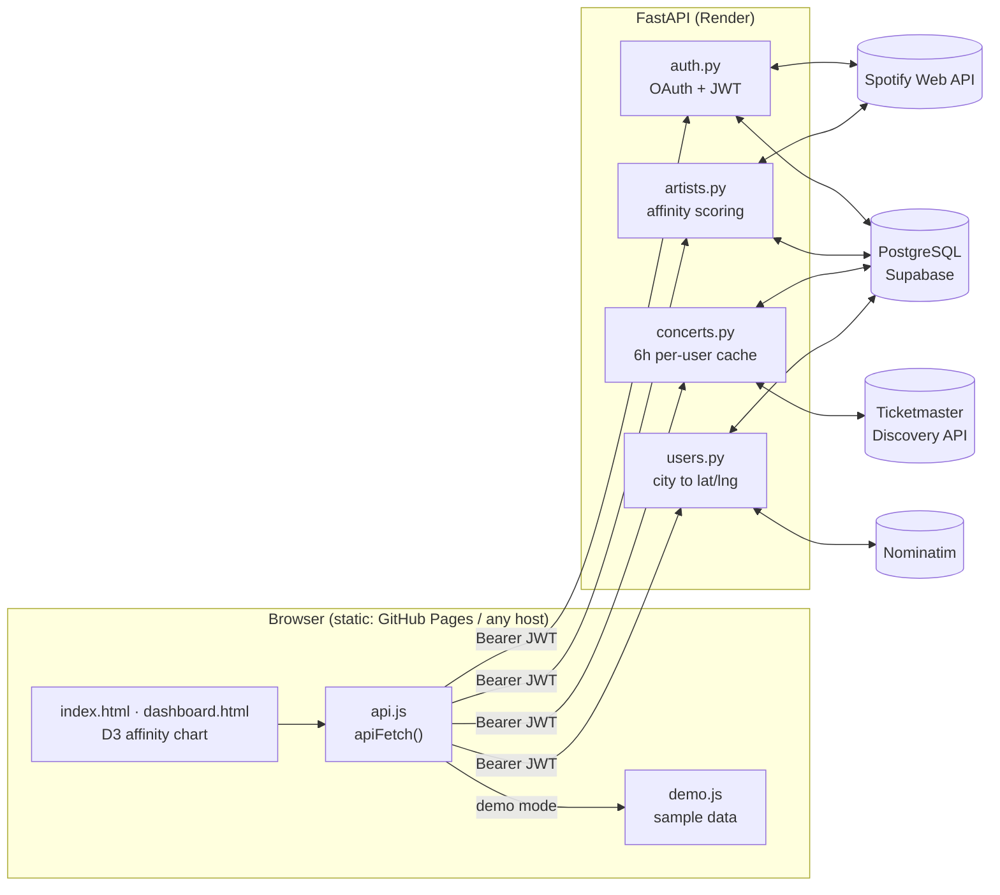

# Concert Radar

Upcoming concerts near you, ranked by how much you listen to each artist on Spotify.

[](https://github.com/ShawnJoshua03/concert-radar/actions/workflows/ci.yml)
[](LICENSE)
[](https://shawnjoshua03.github.io/concert-radar/)


**Live demo:** https://shawnjoshua03.github.io/concert-radar/ (no account needed)

[](https://shawnjoshua03.github.io/concert-radar/)

The hosted demo runs in the browser on made-up artists and shows. Their scores come from the same
formula the backend uses. Logging in with a real Spotify account requires running the backend
yourself (see [Quickstart](#quickstart) and [Limitations](#limitations)).

---

## Why I built it

Ticketing sites list shows by date or distance. I wanted a list sorted by the artists I actually
play, so the shows I'd care about most would be at the top.

## How it works

1. You log in with Spotify. The backend fetches your top 50 artists for three time ranges: about
   the last 4 weeks, the last 6 months, and all time.
2. Each artist gets an affinity score from 0 to 100. Recent listening counts more than older
   listening.
3. For your top 20 artists, the backend searches Ticketmaster for music events within 50 miles of
   your city. The city is converted to coordinates with OpenStreetMap Nominatim. A fuzzy name
   matcher throws out tribute acts and unrelated events that happen to share a keyword.
4. The feed is sorted by affinity, then by date. Results are cached per user for 6 hours.

### Affinity score

Spotify's top-artists endpoint returns ranked lists, not play counts, so the score is based on rank:

| Time range    | Covers           | Weight |
|---------------|------------------|:------:|
| `short_term`  | About 4 weeks    | 3      |
| `medium_term` | About 6 months   | 2      |
| `long_term`   | All time         | 1      |

```
rank_score = 50 - list_index           # #1 gets 50 points, #50 gets 1
raw_score  = sum(rank_score * weight)  # over every range the artist appears in
affinity   = raw_score / 300 * 100     # 300 is the max: #1 in all three ranges
```

Some examples: #1 in the last month only scores 50. #1 all time only scores 16.7. #1 in all three
scores 100.

## Current state

- The full flow works locally: Spotify login, sync, scoring, Ticketmaster search and the ranked feed.
- 39 tests cover the scoring math, Ticketmaster matching and parsing, JWT auth, OAuth state, token
  refresh and per-user caching. They need no network or database and finish in about a second.
  GitHub Actions runs them, plus `ruff`, on every push.
- The demo is a static site: about 40 KB of HTML, CSS and JS, plus D3 from a CDN. It works on
  phone-sized screens.
- I haven't measured the matcher's accuracy. Its thresholds (0.70 for attraction names, 0.82 for
  event titles) were tuned by hand on real searches. I didn't have a labelled dataset.

## Limitations

- New Spotify apps run in Development Mode, which only lets users added in the developer dashboard
  log in. This is why the public link is a demo.
- Only Ticketmaster events are included. AXS, Dice, Eventbrite and many small venues are missing.
- The 20 artist searches run one after another to stay under Ticketmaster's free-tier rate limit,
  so the first uncached load takes a few seconds.
- The search radius is fixed at 50 miles.
- OAuth `state` values are kept in process memory, so the backend has to run as a single worker.
- Spotify tokens are stored unencrypted in Postgres. The session JWT is kept in `localStorage` and
  passes through the redirect URL once. That's acceptable for a personal project but not for
  production.
- The tests replace the database with a fake, so CI never runs the SQL itself. A typo in a query
  would only show up against a real Postgres.
- Render's free tier sleeps when idle (the first request after that takes about a minute), and
  Supabase pauses free projects after a week without activity.

---

## Architecture



| Layer        | Technology                                  | Notes |
|--------------|---------------------------------------------|-------|
| Backend      | Python 3.12, FastAPI, Pydantic v2           | All SQL in `queries.py`, response models in `models.py` |
| Database     | PostgreSQL (Supabase)                       | `users`, `user_artists`, and a per-user `shows` cache |
| Auth         | Spotify OAuth 2.0, HS256 JWT                | Sent as a Bearer token |
| Frontend     | Plain JavaScript, no build step             | Reusable D3 chart: `createAffinityChart(selector, data, options)` |
| Data sources | Spotify Web API, Ticketmaster Discovery, Nominatim | |
| Tooling      | pytest, ruff, GitHub Actions                | |
| Hosting      | GitHub Pages (demo), Render (API)           | |

## Quickstart

To run only the demo (no keys needed):

```bash
python scripts/dev.py web          # then open http://127.0.0.1:3000/?demo
```

To run the full app you need Python 3.12 or newer, a free [Supabase](https://supabase.com) project,
a [Spotify app](https://developer.spotify.com/dashboard) with the redirect URI
`http://127.0.0.1:8000/auth/callback`, and a free
[Ticketmaster API key](https://developer-acct.ticketmaster.com/user/register).

```bash
python scripts/dev.py setup        # creates .venv, installs deps, copies backend/.env.example to backend/.env
# fill in backend/.env, then run schema.sql in the Supabase SQL editor
python scripts/dev.py api          # FastAPI on http://127.0.0.1:8000 (API docs at /docs)
python scripts/dev.py web          # frontend on http://127.0.0.1:3000 (in a second terminal)
python scripts/dev.py test         # pytest
python scripts/dev.py lint         # ruff
```

Use `127.0.0.1` everywhere instead of `localhost`. Spotify requires the redirect URI to match
exactly.

<details>
<summary><b>Environment variables</b></summary>

| Variable | Required | Description |
|----------|:--------:|-------------|
| `SPOTIFY_CLIENT_ID`, `SPOTIFY_CLIENT_SECRET` | yes | From the Spotify Developer Dashboard |
| `SPOTIFY_REDIRECT_URI` | yes | `http://127.0.0.1:8000/auth/callback` locally, `<api-url>/auth/callback` in production |
| `TICKETMASTER_API_KEY` | yes | From the Ticketmaster Developer Portal |
| `DATABASE_URL` | yes | Supabase: Settings, Database, Connection string (URI) |
| `SECRET_KEY` | yes | Generate with `python -c "import secrets; print(secrets.token_hex(32))"` |
| `FRONTEND_URL` | yes | Full URL of `dashboard.html`. Used for the post-login redirect and as the CORS origin |
| `NOMINATIM_CONTACT` | no | Email or URL to include in the Nominatim User-Agent |
| `ENVIRONMENT` | no | `development` (default) or `production` |

</details>

<details>
<summary><b>API reference</b></summary>

| Method | Path | Login | Description |
|--------|------|:-----:|-------------|
| `GET`  | `/auth/login` | | Redirects to the Spotify consent screen |
| `GET`  | `/auth/callback` | | Exchanges the code, saves the user, redirects to `FRONTEND_URL?token=` |
| `GET`  | `/auth/me` | yes | Current user's profile |
| `POST` | `/auth/refresh` | yes | Refreshes the stored Spotify token (sync also does this automatically) |
| `GET`  | `/artists` | yes | Saved top artists with affinity scores |
| `POST` | `/artists/sync` | yes | Re-fetches top artists, recomputes scores, removes artists that dropped off |
| `GET`  | `/concerts` | yes | Upcoming shows near the user, sorted by affinity (cached 6 hours per user) |
| `POST` | `/user/city` | yes | Looks up and saves a city, then clears the concert cache |

</details>

<details>
<summary><b>Deploying your own copy</b></summary>

- Frontend: `.github/workflows/pages.yml` publishes `frontend/` to GitHub Pages on every push to
  `main`. All paths are relative, so it works under a repo subpath.
- Backend: in Render, choose New, then Blueprint, and pick this repo. `render.yaml` defines a free
  web service. Fill in the environment variables, with `FRONTEND_URL` set to your Pages URL plus
  `/dashboard.html`. Then set `PROD_API_BASE` in `frontend/js/api.js` to the Render URL. Once a
  backend is configured the site stops using demo mode, though `?demo` still turns it on.
- In your Spotify app, add `<render-url>/auth/callback` as a redirect URI and add each tester's
  Spotify email under User Management.

</details>

## Project structure

```
concert-radar/
├── backend/
│   ├── main.py                 # FastAPI app and CORS
│   ├── auth.py                 # Spotify OAuth, JWT sessions, token refresh
│   ├── artists.py              # /artists, /artists/sync, affinity scoring
│   ├── concerts.py             # /concerts with a 6h per-user cache
│   ├── users.py                # /user/city
│   ├── ticketmaster_client.py  # Discovery API wrapper and fuzzy artist matching
│   ├── geocoding.py            # Nominatim
│   ├── queries.py              # all SQL
│   ├── models.py               # Pydantic response models
│   ├── database.py             # psycopg2 connection context manager
│   └── tests/                  # pytest suite (fake DB, no network)
├── frontend/
│   ├── index.html, dashboard.html, style.css
│   └── js/  api.js, auth.js, charts.js, demo.js
├── scripts/dev.py              # setup/test/lint/run tasks that also work on Windows
├── schema.sql                  # schema and re-runnable migrations
├── render.yaml                 # Render blueprint for the API
└── .github/workflows/          # CI and Pages deploy
```

## Design decisions and what I learned

**Scoring by rank.** The endpoint I use returns ordered lists instead of play counts. Weighting
the three ranges 3, 2 and 1 and dividing by the maximum possible total (300) gives a 0 to 100
score where current favourites rank above old ones.

**The cache bug.** The first version cached shows by artist for everyone. Two users in different
cities who liked the same artist saw each other's local shows, and changing your city deleted
cached shows for other users. Moving the cache to the user level fixed both. I also started
storing when each user's concerts were last fetched, instead of working it out from the cached
rows. That fixed a second problem: if a city had no matching shows there were no rows, so every
page load searched Ticketmaster again.

**Token refresh.** Spotify access tokens last an hour. There was a refresh endpoint, but nothing
called it, so syncing failed an hour after login. Sync now refreshes the token when it's within a
minute of expiring.

**Bearer tokens instead of cookies.** The frontend and API are on different domains (GitHub Pages
and Render), and browsers increasingly block cross-site cookies. The OAuth `state` is stored on
the server for a related reason: in local development `localhost` and `127.0.0.1` count as
different origins.

**Fuzzy matching.** A Ticketmaster keyword search for an artist also returns tribute bands,
festivals and other acts with similar names. Comparing the artist against the event's listed
performers with `difflib`, and using a stricter threshold when only the event title is available,
removes most of these.

**Demo mode.** All requests already went through one function, `apiFetch()`. Demo mode replaces
what that function calls and leaves the rendering code alone, so the demo uses the same UI code
as the real app.

**Testing without a database.** Since all SQL lives in one module and every connection comes from
`get_db()`, the tests can swap in a fake that records queries. The downside is that the SQL itself
is only checked against a real database (see Limitations).

## Acknowledgements

[Spotify Web API](https://developer.spotify.com/documentation/web-api),
[Ticketmaster Discovery API](https://developer.ticketmaster.com/products-and-docs/apis/discovery-api/v2/),
[OpenStreetMap Nominatim](https://nominatim.org/). Not affiliated with Spotify or Ticketmaster.

## License

[MIT](LICENSE)
