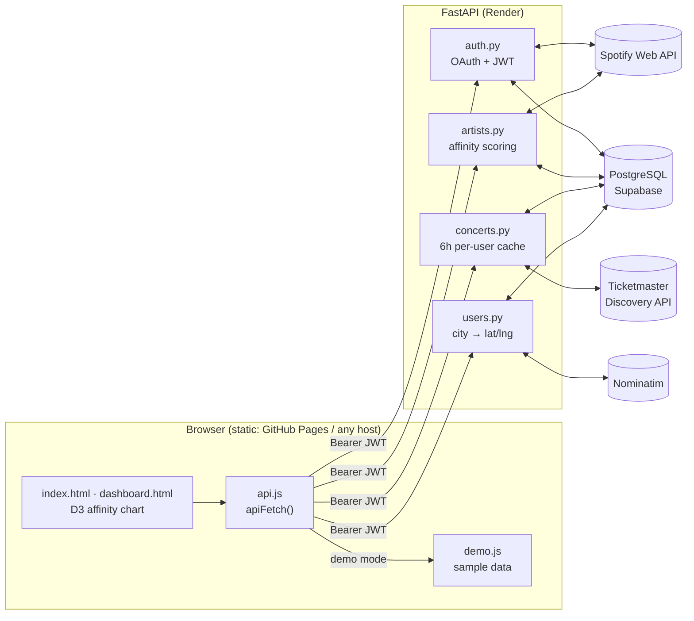

# Concert Radar

**Upcoming concerts near you, ranked by how much you actually listen to the artist.**

[](https://github.com/ShawnJoshua03/concert-radar/actions/workflows/ci.yml)
[](LICENSE)
[](https://shawnjoshua03.github.io/concert-radar/)


### ▶ [Live demo](https://shawnjoshua03.github.io/concert-radar/): no account needed

[](https://shawnjoshua03.github.io/concert-radar/)

> The hosted demo runs entirely in the browser on **fictional** artists and shows, scored by the same
> affinity algorithm as the backend. Real Spotify login needs the backend running; see
> [Quickstart](#quickstart) and [Limitations](#limitations).

---

## The problem

Concert apps sort by date or distance. When you follow hundreds of artists, the show you'd actually
cross town for is buried under ones you'd skip. Your streaming history already knows who you care
about. Nothing connects the two.

## The approach

1. **Connect Spotify.** OAuth 2.0 pulls your top 50 artists in three windows: the last ~4 weeks,
   ~6 months, and all time.
2. **Score affinity.** Each artist gets a 0–100 score that rewards *recent* heavy listening while
   still crediting long-term favourites (details below).
3. **Search Ticketmaster.** For your top 20 artists, search for music events within 50 miles of your
   city (geocoded with OpenStreetMap Nominatim). A fuzzy matcher drops tribute acts and keyword
   collisions.
4. **Ranked feed.** Shows are sorted by affinity, then date. Results are cached per user for 6 hours.

### Affinity score

Spotify's API exposes ranked *top artists*, not play counts, so the score is rank-based:

| Window        | Covers         | Weight |
|---------------|----------------|:------:|
| `short_term`  | Last ~4 weeks  | **3×** |
| `medium_term` | Last ~6 months | **2×** |
| `long_term`   | All time       | **1×** |

```
rank_score   = 50 − list_index          # #1 → 50 points, #50 → 1 point
raw_score    = Σ rank_score × weight     # over every window the artist appears in
affinity     = raw_score / 300 × 100     # 300 = #1 in all three windows
```

An artist you've played on repeat this month (#1 short-term only) scores 50. An all-time favourite
you haven't played lately (#1 long-term only) scores 16.7. One who is both scores 100.

## Results

What the project does today, stated plainly:

- **End-to-end flow works locally**: Spotify login → sync → scoring → Ticketmaster search → ranked feed.
- **39 automated tests** covering scoring math, Ticketmaster matching and parsing, JWT auth, OAuth
  state, token refresh, and per-user caching. They run in about 1 second with no network or database.
  CI runs them plus `ruff` on every push.
- **The demo is static and fast**: about 40 KB of first-party HTML, CSS and JS plus D3 from a CDN,
  with no backend round trip. It has a responsive layout down to phone widths.
- **No accuracy metrics for the matcher yet.** The Ticketmaster fuzzy-match thresholds (0.70 for
  attraction names, 0.82 for event titles) were tuned by hand against real searches, not against a
  labelled dataset.

## Limitations

- **Spotify login is allowlist-only.** New Spotify apps run in Development Mode, where only users
  added in the developer dashboard can log in. That's why the public link is a demo.
- **Ticketmaster only.** It doesn't cover AXS, Dice, Eventbrite or independent venues. The free API
  tier is rate-limited, and the 20 artist searches run sequentially, so the first uncached load
  takes a few seconds.
- **Fixed 50-mile radius** around the saved city.
- **Single-instance backend.** OAuth `state` values live in process memory, so running more than
  one worker would break login.
- **Security trade-offs suited to a portfolio project, not production.** Spotify tokens are stored
  unencrypted in Postgres. The session JWT lives in `localStorage` and arrives once in the redirect
  URL.
- **SQL isn't exercised in CI.** The tests use a fake database layer, so query typos would only
  show up against a real Postgres.
- **Free hosting:** the Render free tier sleeps after inactivity (expect a cold start of about a
  minute), and Supabase pauses projects that sit idle for a week.

---

## Architecture



| Layer        | Technology                                 | Notes |
|--------------|--------------------------------------------|-------|
| Backend      | Python 3.12, FastAPI, Pydantic v2          | All SQL in `queries.py`; response models in `models.py` |
| Database     | PostgreSQL (Supabase)                      | `users`, `user_artists`, per-user `shows` cache |
| Auth         | Spotify OAuth 2.0 + HS256 JWT              | Bearer token avoids cross-site cookie issues between frontend and API hosts |
| Frontend     | Vanilla JS, no build step                  | `createAffinityChart(selector, data, options)` reusable D3 chart |
| Data sources | Spotify Web API, Ticketmaster Discovery, Nominatim | |
| Quality      | pytest, ruff, GitHub Actions               | |
| Hosting      | GitHub Pages (demo) · Render (API)         | |

## Quickstart

**Just the demo (no keys needed):**

```bash
python scripts/dev.py web          # → http://127.0.0.1:3000/?demo
```

**Full app.** You need Python 3.12+, a free [Supabase](https://supabase.com) project, a
[Spotify app](https://developer.spotify.com/dashboard) with redirect URI
`http://127.0.0.1:8000/auth/callback`, and a free
[Ticketmaster API key](https://developer-acct.ticketmaster.com/user/register).

```bash
python scripts/dev.py setup        # creates .venv, installs deps, copies backend/.env.example → backend/.env
# fill in backend/.env, then run schema.sql in the Supabase SQL editor
python scripts/dev.py api          # FastAPI on http://127.0.0.1:8000  (docs at /docs)
python scripts/dev.py web          # frontend on http://127.0.0.1:3000 (in a second terminal)
python scripts/dev.py test         # pytest
python scripts/dev.py lint         # ruff
```

Use `127.0.0.1` rather than `localhost` throughout: Spotify's redirect URI must match exactly.

<details>
<summary><b>Environment variables</b></summary>

| Variable | Required | Description |
|----------|:--------:|-------------|
| `SPOTIFY_CLIENT_ID` / `SPOTIFY_CLIENT_SECRET` | ✅ | Spotify Developer Dashboard |
| `SPOTIFY_REDIRECT_URI` | ✅ | `http://127.0.0.1:8000/auth/callback` locally; `<api-url>/auth/callback` in production |
| `TICKETMASTER_API_KEY` | ✅ | Ticketmaster Developer Portal |
| `DATABASE_URL` | ✅ | Supabase → Settings → Database → Connection string (URI) |
| `SECRET_KEY` | ✅ | `python -c "import secrets; print(secrets.token_hex(32))"` |
| `FRONTEND_URL` | ✅ | Full URL of `dashboard.html`; used as the post-login redirect and CORS origin |
| `NOMINATIM_CONTACT` | | Email or URL for the Nominatim User-Agent |
| `ENVIRONMENT` | | `development` (default) or `production` |

</details>

<details>
<summary><b>API reference</b></summary>

| Method | Path | Auth | Description |
|--------|------|:----:|-------------|
| `GET`  | `/auth/login` | | Redirects to the Spotify consent screen |
| `GET`  | `/auth/callback` | | Exchanges the code, upserts the user, redirects to `FRONTEND_URL?token=` |
| `GET`  | `/auth/me` | ✅ | Current user profile |
| `POST` | `/auth/refresh` | ✅ | Refreshes the stored Spotify token (also done automatically on sync) |
| `GET`  | `/artists` | ✅ | Stored top artists with affinity scores |
| `POST` | `/artists/sync` | ✅ | Re-fetches top artists, recomputes scores, prunes artists that dropped out |
| `GET`  | `/concerts` | ✅ | Upcoming shows near the user, sorted by affinity (6 h per-user cache) |
| `POST` | `/user/city` | ✅ | Geocodes and saves a city, invalidates the concert cache |

</details>

<details>
<summary><b>Deploying your own</b></summary>

- **Frontend:** `.github/workflows/pages.yml` publishes `frontend/` to GitHub Pages on every push
  to `main`. Paths are relative, so it works under a repo subpath.
- **Backend:** in Render, choose **New → Blueprint** and select this repo. `render.yaml` defines a
  free web service. Fill in the env vars, setting `FRONTEND_URL` to your Pages URL plus
  `/dashboard.html`. Then set `PROD_API_BASE` in `frontend/js/api.js` to the Render URL. The site
  leaves demo mode automatically once a backend is configured, and `?demo` still opts back in.
- Add `<render-url>/auth/callback` as a redirect URI in your Spotify app, and add each tester's
  Spotify email under **User Management**.

</details>

## Project structure

```
concert-radar/
├── backend/
│   ├── main.py                 # FastAPI app + CORS
│   ├── auth.py                 # Spotify OAuth, JWT sessions, token refresh
│   ├── artists.py              # /artists, /artists/sync, affinity scoring
│   ├── concerts.py             # /concerts, per-user 6h cache
│   ├── users.py                # /user/city
│   ├── ticketmaster_client.py  # Discovery API wrapper + fuzzy artist matching
│   ├── geocoding.py            # Nominatim
│   ├── queries.py              # all SQL
│   ├── models.py               # Pydantic response models
│   ├── database.py             # psycopg2 connection context manager
│   └── tests/                  # pytest suite (fake DB, no network)
├── frontend/
│   ├── index.html · dashboard.html · style.css
│   └── js/  api.js · auth.js · charts.js · demo.js
├── scripts/dev.py              # cross-platform setup/test/lint/run tasks
├── schema.sql                  # schema + idempotent migrations
├── render.yaml                 # Render blueprint for the API
└── .github/workflows/          # CI + Pages deploy
```

## Design decisions & what I learned

- **Rank-based scoring with a recency bias.** Spotify doesn't expose play counts through this API,
  only ordered top lists. Weighting the three windows 3/2/1 and normalising against the theoretical
  max (300) gives a stable 0–100 score. "Currently obsessed" beats "liked years ago", and an artist
  who is both wins.
- **A cache keyed by the wrong thing is a correctness bug, not a performance one.** v1 cached shows
  globally by artist. Two users in different cities who shared an artist saw each other's local
  shows, and changing your city deleted other users' cache. Scoping the cache to the user, and
  tracking `concerts_fetched_at` instead of inferring freshness from `MIN(cached_at)`, fixed both.
  It also fixed a quieter problem: cities with zero matching shows used to re-query Ticketmaster on
  every page load.
- **Tokens expire in production, not in demos.** Spotify access tokens last an hour. The refresh
  endpoint existed but nothing called it, so sync broke an hour after login. Sync now refreshes
  transparently 60 s before expiry.
- **Bearer tokens over cookies** because the frontend and API live on different domains (Pages and
  Render). Third-party cookie rules make cookie sessions brittle there. The OAuth `state` is kept
  server-side for the same reason: `localhost` and `127.0.0.1` are different cookie origins.
- **Fuzzy matching is necessary.** Ticketmaster keyword search returns tribute bands, festivals and
  name collisions. Matching against the event's *attractions* with `difflib` (and a stricter
  threshold when falling back to the event title) removes most of them.
- **Demo mode as a drop-in for the network layer.** Every request already went through `apiFetch()`,
  so the demo swaps the transport and leaves the rendering code untouched. The demo exercises the
  real UI, and the convention "all HTTP goes through `api.js`" paid off.
- **Testable without infrastructure.** Keeping SQL in one module and opening connections through a
  single `get_db()` made it easy to substitute a recording fake in tests. The trade-off is that SQL
  correctness needs a real Postgres to verify (see Limitations).

## Acknowledgements

[Spotify Web API](https://developer.spotify.com/documentation/web-api) ·
[Ticketmaster Discovery API](https://developer.ticketmaster.com/products-and-docs/apis/discovery-api/v2/) ·
[OpenStreetMap Nominatim](https://nominatim.org/). This project is not affiliated with Spotify or
Ticketmaster.

## License

[MIT](LICENSE)
